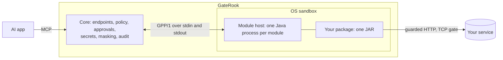

# How a connector module is built

A connector module adds connector types to [GateRook](https://gaterook.com): the kinds of connection a person can make, each with its connection form and its tools. A module is one JAR. It is not part of the application: GateRook loads it into a separate process when a connection needs it.

This document describes that architecture for anyone who writes a module: the modules in this repository and your own. [`examples/hello`](../examples/hello) is the smallest working module, with a build you can copy.

## Contents

- [The parts](#the-parts)
- [The path of a call](#the-path-of-a-call)
- [The package](#the-package)
- [`module.json`](#modulejson)
- [The code](#the-code)
- [Tools](#tools)
- [The connection form and secrets](#the-connection-form-and-secrets)
- [Reads, changes and approvals](#reads-changes-and-approvals)
- [What a module may reach](#what-a-module-may-reach)
- [GateRook's modules and yours](#gaterooks-modules-and-yours)
- [Names and versions](#names-and-versions)
- [Build, test and install](#build-test-and-install)
- [Checklist](#checklist)

## The parts



| Part | What it is | Where its source is |
| --- | --- | --- |
| Core | The application's own process. It publishes endpoints to AI apps, decides who may call what, asks a person for approval, keeps secrets, masks results and writes the audit trail. | [Application repository](https://github.com/gaterook/gaterook) |
| Connector API | The Java interfaces a module implements: `ConnectorModule`, `Connector` and the types around them. The module host provides them at run time. | `connector-api` of the application repository; the [SPI reference](https://github.com/gaterook/gaterook/blob/main/docs/connector-spi.md) lists every type |
| Module host | A Java process the core starts for one module, in an OS sandbox, with a cleared environment and its own data folder. It loads the package and answers the core over GPP/1, JSON-RPC on its standard input and output. | `plugin-host` of the application repository |
| Package | Your module: one JAR with your classes, the libraries you bring and a manifest. | Yours |

A module knows nothing about endpoints, AI apps, tokens or people. It says what its connector types are, and it judges, describes and runs the calls the core hands it. Everything else is the core's: a module cannot publish a tool to an agent, skip an approval, read another connection's secrets or write to the audit trail.

All connector types of one module share one host process. The host starts on the first call and stops when it is idle; the core reads a module's card, form and tools from the manifest it stored at installation, so listing tools never starts a process.

## The path of a call

1. An AI app calls a tool on an endpoint. The core validates the arguments against the tool's `inputSchema`, resolves `connection` and removes it from the arguments.
2. The core asks the module to **classify** the call: a read, a change or a refusal. Classification does no I/O and sees no secret. A classification that doesn't arrive is a refusal.
3. The core applies the policy and the tool's mode on that endpoint. A read runs at once when the tool is in **Read only** or **Bypass**. A change, and every call of a tool in **Approval**, waits for a person; only **Bypass** lets a change run without one.
4. For a call that waits, the core asks the module to **describe** it: the exact action, byte for byte what will run. A person approves that action, and its digest binds the approval to the call. For a module GateRook didn't sign, the person approves the call's arguments instead, with the module's description beside them ([GateRook's modules and yours](#gaterooks-modules-and-yours)).
5. The core asks the module to **execute** the call, with a context that says whether it is approved. While the call runs, the module may ask the core for the connection's secrets and may reach only what the call's grant allows.
6. The core masks and bounds the result, writes the audit record and answers the AI app.

A call that can't reach its connector fails closed. A change whose answer doesn't arrive is reported as unknown and is never sent twice.

## The package

A module is one JAR:

| Entry | What |
| --- | --- |
| `mcp-gateway-plugin.json` | The manifest, at the root of the JAR: what the module is and what its connector types and tools are. The build writes it; see below. |
| Your classes | The entry point and the connectors, in a package of your own, such as `com.example.hello`. |
| Libraries | The classes of every library the module needs, in the same JAR. A module can't bring nested JARs. |
| License and notice files | Those of the libraries you bring, as their licenses require. |

A package may not contain the classes the host provides, because the host serves them first and a copy would be dead weight at best: `com.gaterook.connector.api`, `com.gaterook.plugin.protocol`, `com.gaterook.pluginhost`, Jackson 3 (`tools.jackson`), `com.fasterxml.jackson.annotation`, PF4J (`org.pf4j`) and the SLF4J API (`org.slf4j`). Compile against the connector API and Jackson with the `provided` scope. A library that logs through SLF4J finds the host's.

GateRook checks a package before a class of it loads:

| Limit | Value |
| --- | --- |
| Size of the JAR | 150 MB |
| Size of its contents, uncompressed | 600 MB |
| Entries | 60,000 |
| Manifest | 4 MB |
| Connector types | 32 |
| Tools of one connector type | 128 |
| One tool's input or output schema | 64 KB |

### The manifest

`mcp-gateway-plugin.json` has `"manifestVersion": 2` and lists the module's connector types, each with its name, icon, group, description, connection form (`configSchema`), optional policy form (`policySchema`) and tools. You don't write it. The build runs `ModuleManifests`, a class of the application's `plugin-protocol` artifact, which instantiates your module class, asks it for its connectors and writes the manifest from what they say, together with the fields of `module.json`. The file therefore can't disagree with the code, and a module whose manifest GateRook would refuse doesn't build.

At load, the host compares again: a module whose code gives other connector types or other tool definitions than its manifest declares is refused.

## `module.json`

The descriptor holds what the code doesn't say. It lies beside the module's `pom.xml`.

```json
{
  "id": "hello",
  "version": "1.0.0",
  "name": "Hello",
  "provider": "Example",
  "license": "Apache-2.0",
  "description": "Greets by name and keeps one-line notes in its own folder.",
  "moduleClass": "com.example.hello.HelloModule",
  "requires": {
    "gateway": ">=0.9.2 & <1.0.0",
    "connectorApi": ">=2.0.0 & <3.0.0",
    "javaModules": []
  },
  "access": {"hosts": [], "commands": [], "files": []},
  "resources": {"maxHeapMb": 64, "maxMetaspaceMb": 64, "maxInFlight": 4}
}
```

| Field | Meaning |
| --- | --- |
| `id` | The module's id: a lower-case letter, then 1 to 47 lower-case letters, digits or dashes. |
| `version` | The module's own version, `major.minor.patch`. It has nothing to do with the application's version. |
| `name`, `description` | What a person sees: at most 64 and 500 characters, without hidden characters. |
| `provider`, `license` | Who made the module, and its license. |
| `moduleClass` | The entry point: a class of yours with a public no-argument constructor that implements `ConnectorModule`. |
| `requires.gateway` | The application versions the module runs with, as a range. |
| `requires.connectorApi` | The connector API versions it runs with. Modules need 2.0.0 or later: the API whose packages are under `com.gaterook`. |
| `requires.javaModules` | The modules of the Java platform the code and its libraries need beyond `java.base`, such as `java.sql` or `java.net.http`. GateRook refuses a package that needs one its Java runtime lacks. |
| `access` | Where the module goes: see [what a module may reach](#what-a-module-may-reach). |
| `resources.maxHeapMb` | The host's Java heap, 64 to 1024 MB. |
| `resources.maxMetaspaceMb` | The host's metaspace, 64 to 512 MB. |
| `resources.maxInFlight` | The calls the host runs at once, 1 to 64. |

`module.json` declares neither `manifestVersion` nor `types`: the build writes both.

## The code

A module has an entry point and one connector for each connector type.

```java
public final class HelloModule implements ConnectorModule {

  @Override
  public List<Connector> connectors(ModuleContext context) {
    return List.of(new HelloConnector(context.moduleVersion()));
  }
}
```

The host instantiates `moduleClass` once, calls `connectors` once and keeps the connectors as long as the module is loaded. `ModuleContext` gives the module its own id and version, nothing of the gateway.

A `Connector` is one connector type:

| Method | What it does | Rules |
| --- | --- | --- |
| `manifest()` | Says what the type is: its id, name, icon, group, description, connection form and tools. | The type's kind is `ConnectorManifest.Kind.BUILT_IN`. Its tools are fixed: a module's connector can't declare dynamic tools. |
| `classify(call, cfg, policy)` | Judges a call: `Classification.read()`, `.mutation(reason)` or `.deny(ruleId, reason, hint)`. | No I/O and no secrets, a few milliseconds. It runs on every call, before the policy. |
| `describeAction(call, cfg)` | Says what a person approves. | No I/O. The text is exactly what will run, never a paraphrase. |
| `test(cfg, secrets, ctx)` | Test connection: reaches the service and says what the account may do. | Saves nothing. |
| `execute(call, cfg, secrets, ctx)` | Runs the call. | A read, or a change only when `ctx.approved()`. |

The rest of the interface is optional and has defaults: `prepare` (a dry run or an impact estimate before the approval exists), `suggest` (help for the connection form while a person fills it in), `discoverDatabases`, `describe`, `supportsTool`, `maxConcurrency` and others. The [SPI reference](https://github.com/gaterook/gaterook/blob/main/docs/connector-spi.md) describes each.

A connector's methods are blocking and may be interrupted: react to the interrupt and to `ctx.deadline()`. Start no thread pools of your own, never call `System.exit` or `System.setProperty`, and install no JVM-wide defaults. Write files only under `ctx.workDir()`, the module's data folder.

A module with several connector types returns several connectors. Types of one module may share a tool name when the tool is the same for all of them.

## Tools

A tool is a `ToolDefinition`:

```java
ToolDefinition note = ToolDefinition.builder("hello_note")
    .title("Add a note")
    .description("Adds one line to the connection's notes. A person approves the line first.")
    .inputSchema(json(NOTE_INPUT))
    .annotations(ToolDefinition.Annotations.write(false))
    .nature(ToolDefinition.Nature.MUTATION)
    .defaultMode(ToolDefinition.Mode.APPROVAL, ToolDefinition.Mode.APPROVAL)
    .resultShape(ToolDefinition.ResultShape.TEXT)
    .build();
```

| Part | Rules |
| --- | --- |
| Name | A lower-case letter, then up to 63 lower-case letters, digits or underscores. Give all tools of a type one prefix, such as `hello_`: see [names](#names-and-versions). |
| Title, description | At most 200 and 2,000 characters, without hidden characters. An agent reads them to decide what to call. |
| `inputSchema` | A JSON Schema of an object. Its first property is `connection`, a string that is required: the core fills in which connections the endpoint offers. |
| `outputSchema` | Optional, and only for a read. |
| Nature | `READ`, `MUTATION`, or `MIXED` when `classify` decides per call. |
| Annotations | The four MCP hints, all declared: `Annotations.read()` or `Annotations.write(destructive)`. |
| Default modes | The mode the tool starts in on a development or staging endpoint and on a production one: `OFF`, `READ_ONLY`, `APPROVAL` or `BYPASS`. A `MUTATION` can't default to `READ_ONLY`. GateRook's own connectors start reads in `READ_ONLY` and changes in `APPROVAL`. |
| Result shape | `TABLE`, `JSON`, `TEXT` or `LOGS`: how the core renders the result. |
| Risk | Whether results hold private data or untrusted content, and whether the tool can send data out (`NONE`, `LIMITED`, `CHANNEL`). The builder's default is the cautious one: private data and untrusted content. |

A result is a `ToolResult`: `ToolResult.json(node, text)`, `.table(...)`, `.text(...)` or `.error(message)`. An answer of the service that reports a problem, such as a syntax error, is a result with `isError`, because the agent can act on it. Trouble reaching the service is a `ConnectorException`, which the core counts against the connection. The core masks and cuts every result before anything leaves GateRook; a connector can't opt out.

## The connection form and secrets

`configSchema` is a JSON Schema (2020-12) of an object. GateRook renders the connection form from it and validates a connection against it.

```json
{
  "type": "object",
  "additionalProperties": false,
  "required": ["host", "user"],
  "properties": {
    "host": {"type": "string", "title": "Host", "description": "The server: db.example.com"},
    "port": {"type": "integer", "minimum": 1, "maximum": 65535, "default": 8443, "title": "Port"},
    "user": {"type": "string", "title": "User"},
    "password": {"type": "string", "writeOnly": true, "format": "password", "title": "Password"}
  }
}
```

A property with `"writeOnly": true` is a secret. GateRook stores it encrypted and never puts it in `ConnectionConfig`: the connector asks `SecretResolver` for it by its JSON pointer, while a call runs.

```java
try (SecretResolver.Secret password = secrets.secret("/password")) {
  // Use password.chars() for this request only.
}
```

A secret is scoped to one connection and one call, and it is closed when the call ends. Every value the resolver hands out is tainted: the core masks it wherever it shows up in a result. A credential the connector obtains itself, such as a session token, is reported with `ctx.taint(value)` so that it is masked the same way.

A setting that only the person may make, such as the path of a file on their computer, is marked `"x-person-only": true`: an agent's connection proposal can't set it. The modules in this repository show the other form keywords in use (`title`, `default`, sections that start collapsed, a file chooser).

## Reads, changes and approvals

The rule for a tool that changes something has three parts, and a module implements all three.

**Classify.** Say what the call is before anything runs. The classifier is the place for the module's own rules, such as "one statement" or "no file functions": return `Classification.deny` with a rule id from `policy.rule("…")` and words the agent can act on. Refuse what you can't read with certainty.

**Describe.** `describeAction` returns an `ActionPreview`: the text that will run, the target, a one-line summary and optional fields, impact and warnings. A preview may carry a `payload` with what `execute` needs. For one of GateRook's own modules the core stores it with the approval and hands it back as `ctx.approvedPayload()`. For a module of your own the person approves the call's arguments themselves, with your description beside them as not verified, and the approved call is what `execute` receives. So write `execute` to work from the call's arguments when no payload comes back.

**Execute.** Refuse a change unless `ctx.approved()`, and run what was approved rather than whatever the arguments say now:

```java
if (!ctx.approved()) {
  throw ConnectorException.denied("Not approved: hello_note changes the notes, so a person approves it first.");
}
String text = ctx.approvedPayload().filter(p -> p.path("text").isString())
    .map(p -> p.get("text").asString()).orElse(call.string("text"));
```

The core never sends an unapproved change, so the check in `execute` is a second lock, and worth having. Never retry a change: when its outcome isn't known, throw `ConnectorException.outcomeUnknown`.

## What a module may reach

A module's process is confined, and its manifest says where it goes. A person reviews that list before they install a module that GateRook didn't sign.

**HTTP.** Send requests through `ctx.egress()`, the host's guarded client. It reaches only the hosts `access.hosts` declares, filled in for the call's connection:

```json
"access": {"hosts": ["{connection.host}:8443", "api.example.com"], "commands": [], "files": []}
```

`{connection.host}` is the host of the connection: of its `baseUrl`, `url`, `endpoint` or `serverUrl` field, or its `host` field. `{connection.port}` is its `port` field, or that field's default in the schema. An entry is `name`, `name:port` or `[ipv6]:port`; without a port it means any port. An entry the connection can't fill in grants nothing. The client uses HTTPS, follows no redirects and never reaches cloud metadata addresses, link-local addresses or GateRook's own ports. A private address, `127.0.0.1` included, is reached only when the connection's environment allows its range in the policy (`http.allowedPrivateRanges`), and plain HTTP goes only to such an address.

**Other TCP connections.** A library that opens its own sockets, such as a JDBC driver, is confined by the host's TCP gate. Declare its destinations in `access.tcp`:

```json
"access": {"hosts": [], "commands": [], "files": [], "tcp": ["{connection.host}:{connection.port}"]}
```

An entry is `host:port` without wildcards. The gate then carries every `java.net.Socket` of the process and lets it reach only those destinations, under the same address rules as the HTTP client and only while a call runs. A module that declares no `access.tcp` gets no gate; its sockets are then limited only by the sandbox. The gate binds ordinary sockets: NIO channels, datagrams and native code go past it. [`modules/h2`](../modules/h2) is a module behind the gate.

**Files and commands.** `access.files` and `access.commands` are statements for the person who reviews the package: what the module opens and what it runs. They open nothing by themselves. What the process can touch is decided by the sandbox.

**The sandbox.** The core starts every module host confined by the operating system, with a cleared environment:

- on macOS under `sandbox-exec`: the process writes only its own data folder, and can't read GateRook's home or the credential folders `~/.ssh` and `~/.aws`;
- on Linux under Landlock where the kernel supports it: the process reads its runtime and its package and writes only its data folder;
- on Windows at low integrity: the process can't write the person's files or read GateRook's home.

GateRook's own ports are closed to a module's sockets wherever the system can enforce it. A module that needs to change a file outside its data folder can't do so on macOS: design for that, as the [DuckDB](duckdb.md) and [Microsoft Access](access.md) modules do.

**The data folder.** `ctx.workDir()` is the module's own folder. Keep caches and state there; it is the only place a module can count on writing.

**Memory and time.** The host's heap and metaspace are those of `module.json`. Every call has a deadline (`ctx.deadline()`), and the limits of the call (`ctx.limits()`: rows, response size, cell size, timeouts) are the smallest of what the environment's policy, the connection, the endpoint and the tool allow. Hold a call to them yourself where your service lets you; the core cuts what is larger anyway.

## GateRook's modules and yours

Where a package came from decides how far GateRook trusts it. Nothing in the package can claim more.

A package that GateRook's signed list of modules pins, by version and SHA-256, is GateRook's own module. It installs without a question and updates by itself. The list holds GateRook's modules only; [the README](../README.md) describes how GateRook verifies it.

Any other package is **your own module**. A person installs it from a file, in **Connectors → Add connector → Install plugin or module**, after a review that shows what it is, what it reaches and that nobody signed it. GateRook then takes its word for nothing, as it does for an unsigned plugin:

| | GateRook's module | Your own module |
| --- | --- | --- |
| Connector types | Built-in types: plain tool names, a card among the connectors | The same, with a card that says `Your module, unsigned` |
| Tool modes on an endpoint | The defaults the connector declares | Every tool starts in **Approval**, whatever it declares |
| Read only | As the connector declares | The person's confirmation per tool, bound to the tool's definition and to this very package |
| What a person approves | The connector's exact action | The call's arguments; the module's own description is shown beside them as not verified |
| Classification | The connector's own | The connector's own, with its rule ids and words confined as a plugin's are |
| Tools that depend on the endpoint, template kinds | Yes | No: only the declared tools |
| Updates | Follows the list | None from the list: install a newer file |
| Sandbox, egress rules, secrets, masking, audit | The same | The same |

A module of your own is a full connector for the person who installs it. The difference is that they, not GateRook, vouch for it, tool by tool.

## Names and versions

**Names.** A module of your own may not take a name that is somebody else's:

- its connector type ids are not those of a connector of the application, of another installed package or of another module in GateRook's list;
- none of its tools has the name of another connector's tool;
- none of its tools starts with a prefix that the tools of another connector start with. The prefix is the name up to and including the first underscore: `sql_`, `ssh_`, `mongo_`, `duckdb_` and so on are taken.

Choose one prefix for your tools that is specific to your module or your organisation, and use it for the module id too. GateRook says which name is taken when it refuses a package.

One case is different: your own build of a module that GateRook's list has, under that module's id. It keeps the module's names and takes the place of GateRook's build, as an unsigned module, until you return to GateRook's build in **Connectors → Installed**.

**Versions.** `requires.gateway` and `requires.connectorApi` are ranges such as `>=2.0.0 & <3.0.0`. GateRook refuses a package whose ranges don't include its own versions, and says which it has. Within a major version the connector API only grows, which is why the modules here accept every 1.x from 1.2 on. Build manifests and tools with the builders (`ConnectorManifest.builder`, `ToolDefinition.builder`), not with the records' constructors, which may gain components.

A module's own version changes whenever its package does. GateRook never replaces an installed version with another build of the same version: give a changed build a higher version in `module.json`, and install the new file. What waits for approval on the module's connections is then rejected, because the old code described it, and a tool that ran in Read only waits for the person's confirmation again.

## Build, test and install

**Prerequisites.** JDK 25, Maven 3.9 or later, and three artifacts of the application in your local Maven repository: `connector-api`, `plugin-protocol` and `plugin-host`. [The README](../README.md#build-a-module) has the commands.

**Build.** The build has three steps, which [`examples/hello/pom.xml`](../examples/hello/pom.xml) shows in full:

1. compile against `connector-api` and Jackson with the `provided` scope;
2. run `ModuleManifests` on the compiled classes with `module.json`, which writes `mcp-gateway-plugin.json` into the classes folder;
3. put the classes, the manifest and your libraries into one JAR with the shade plugin, leaving out signature files of libraries.

```bash
mvn -B -ntp -f examples/hello/pom.xml package
```

**Test the connector.** A connector is plain Java: call `classify`, `describeAction`, `test` and `execute` in a unit test, with a `ConnectionConfig` you make and an `ExecContext` of your own. [`HelloConnectorTest`](../examples/hello/src/test/java/com/example/hello/HelloConnectorTest.java) does that in a page, and checks that the build's manifest is one GateRook accepts.

**Test the package in a module host.** The modules in this repository also load their built JAR in a real module host, started the way the core starts one, sandboxed on macOS. That proves what a unit test can't: that the package loads, that the tools the code serves are the ones the manifest declares, and that the egress rules and the sandbox let the connector do its work. See [`ClickHouseModuleHostIT`](../modules/clickhouse/src/test/java/com/gaterook/connectors/clickhouse/ClickHouseModuleHostIT.java) for HTTP and [`H2ModuleHostIT`](../modules/h2/src/test/java/com/gaterook/connectors/h2/H2ModuleHostIT.java) for the TCP gate.

**Install it.** In GateRook, open **Connectors → Add connector → Install plugin or module** and choose the JAR. The review names the module, its connector types and tools, what it reaches and its SHA-256, and asks you to confirm that you trust it. The module's connector types then appear in **Add connection**. Add a connection, add it to an endpoint, and call a tool: it waits for your approval, as every tool of your own module does at first. **Connectors → Installed** shows the module with its version; its menu uninstalls it once no connection uses it.

**Share it.** A module of your own is a file: give the JAR, its SHA-256 and its source to the people who should use it. Each of them installs it from the file and confirms it themselves.

## Checklist

- The module id, the connector type ids and the tool prefix are yours alone.
- Every tool's `inputSchema` starts with a required `connection`.
- Reads are `READ` with `Annotations.read()`; a tool that can change anything is `MUTATION` or `MIXED`.
- `classify` does no I/O, and refuses what it can't read.
- `describeAction` shows exactly what will run, and `execute` runs what was approved.
- `execute` refuses a change unless `ctx.approved()`.
- Secrets are `writeOnly` properties, read through `SecretResolver` for one call and closed.
- HTTP goes through `ctx.egress()`; a library's own sockets are declared in `access.tcp`.
- Files are written under `ctx.workDir()` only.
- The JAR holds none of the packages the host provides, and no nested JARs.
- `module.json` and the build agree on the version, and a changed package gets a higher one.
